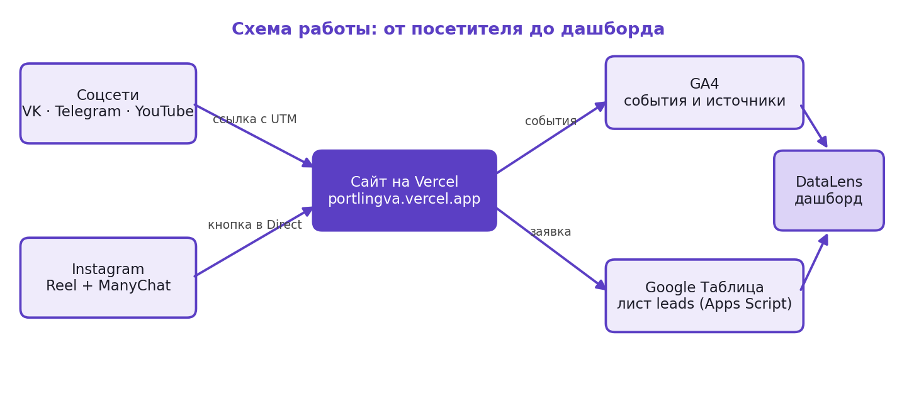

# Портлингва — сайт языковой школы и сквозная аналитика

Практическая работа по дисциплине ОП.03 «Информационные технологии», ТЗ № ТЗ-05/2026, АНО ДО «Портлингва».
Исполнитель: **Михеев Николай Сергеевич**, группа РПО-26/1/11.

## Ссылки

| Что | Ссылка |
|---|---|
| Сайт на Vercel | https://portlingva.vercel.app |
| Репозиторий | https://github.com/k0mpas-1/portlingva |
| Таблица заявок «Portlingva — Leads» | https://docs.google.com/spreadsheets/d/1B8_DCw0lP4tSj5M1etOccMogSZzZ1N2-YNo8vCztiaw/edit |
| Приёмник заявок (Apps Script Web App) | https://script.google.com/macros/s/AKfycbx3i_CPDQorKrFjSPwUCPimpWlNNUp3j1z0SDAE8PFANyXaME-K5-zokeLfjoz9WmMfNw/exec |
| Дашборд DataLens | не выполнено: сервис не работал (см. внизу) |
| Instagram (Reel с автоответами) | _вставить ссылку на Reel_ |
| ВКонтакте — сообщество | _вставить_ |
| Telegram — канал | _вставить_ |
| YouTube — видео | _вставить_ |
| Реестр ссылок | [docs/utm.md](docs/utm.md) · [docs/utm.csv](docs/utm.csv) |
| Таблица событий GA4 | [docs/events.md](docs/events.md) |
| Журнал запросов к нейросети | [docs/prompts.md](docs/prompts.md) |
| Аналитическая записка | [docs/report.md](docs/report.md) |

**Ресурс GA4:** «ПОРТЛИНГВА — сайт», Measurement ID **`G-2CZ494QV10`**, поток Portlingva (16231844524).

Доступ Viewer к ресурсу GA4 выдан: ___ (e-mail Заказчика)

---



## Что сделано

| Раздел ТЗ | Результат |
|---|---|
| 3. Сайт | 9 страниц + 404, статический HTML/CSS/JS без сборки; адаптив 375/768/1280; OG-теги и favicon; Lighthouse mobile **99 / 94 / 100 / 100** |
| 4. GA4 | тег в `<head>` всех 10 страниц, 20 событий (6 авто + 14 своих) из одного файла `js/analytics.js`, 7 пользовательских параметров, ключевые события `generate_lead`, `contact_click`, `messenger_click` |
| 5. UTM | реестр из 12 ссылок по правилам 5.1, QR-код и афиша для визиток |
| 6. Заявки | форма → `fetch` → Apps Script → лист `leads`; проверка полей на сайте и на сервере, защита от повторного `request_id`, статусы со списком и подсветкой |
| 7. Instagram | ManyChat: автоответ под Reel, ветки «ФРАЗЫ» и «КИТАЙСКИЙ» ([docs/manychat.md](docs/manychat.md)) |
| 8. Отчёты | Reports, Explore, атрибуция, оповещение ([docs/reports.md](docs/reports.md)); дашборд DataLens не выполнен — сервис не работал, подготовлена инструкция [docs/datalens.md](docs/datalens.md) |

## Структура

```
index.html courses.html level-test.html teachers.html prices.html
phrases.html contacts.html thanks.html privacy.html 404.html
css/style.css          общий стиль (цвета и шрифты из ТЗ, раздел 2)
js/analytics.js        все события GA4
js/main.js             меню, UTM в sessionStorage, фильтры, промокод
js/form.js             форма заявки → Apps Script
js/level-test.js       тест уровня (12 вопросов)
img/  files/           изображения WebP/JPEG, видео, PDF
apps-script/Code.gs    приёмник заявок
docs/                  prompts, events, utm, images, level-test, report, инструкции, QR, афиша
screens/               снимки: site, ga4, sheets, utm, instagram, reports, explore, datalens, lighthouse
```

## Как проверить

- **Отладка событий:** открыть сайт с `?ga_debug=1` → GA4 → Admin → DebugView. Выключить: `?ga_debug=0`.
- **Заявка:** перейти по ссылке из реестра, отправить форму → строка в листе `leads` с метками, в DebugView `generate_lead`.
- **Сценарий приёмки И-01…И-13:** [docs/acceptance.md](docs/acceptance.md).

## Технологии

HTML, CSS, JavaScript · Google Analytics 4 (gtag.js) · Google Таблицы и Apps Script · ManyChat · GitHub и Vercel.

---

Не получилось: дашборд в Yandex DataLens (п. 8.4) — сервис DataLens не работал во время выполнения, поэтому подключение к таблице и дашборд не созданы; описание датасетов, формул и вкладок подготовлено в docs/datalens.md. Публикации во ВКонтакте, Telegram и YouTube не делались — ссылки U-05…U-09 подготовлены в реестре. Живой тест автоответов ManyChat комментарием со второго аккаунта Instagram не проводился (нет второго аккаунта); автоматизации включены и проверены в предпросмотре.

Нейросеть использовалась для: генерации стартовой версии сайта (ChatGPT), переработки дизайна, кода страниц и скриптов, приёмника Apps Script, документации и настройки сервисов (Claude). Все запросы — в [docs/prompts.md](docs/prompts.md).
