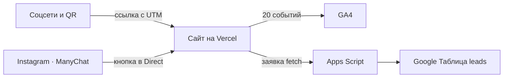
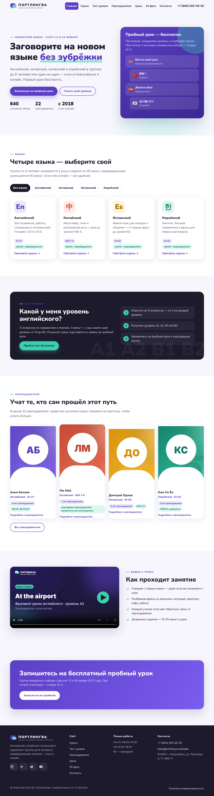
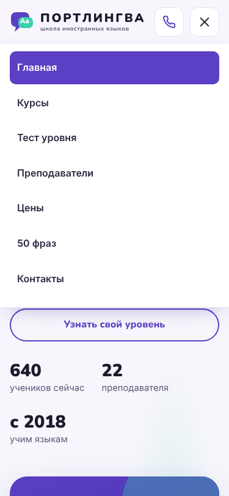
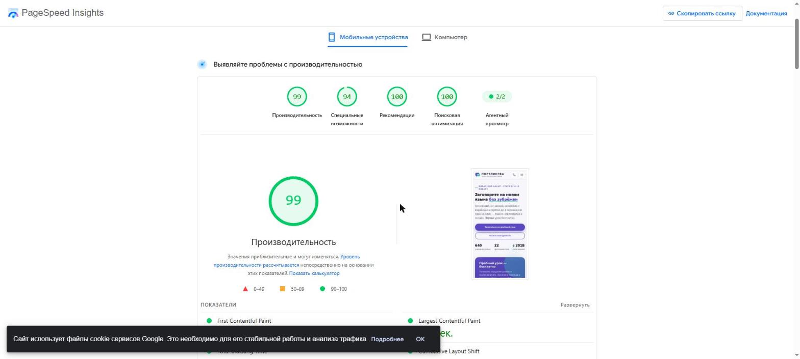
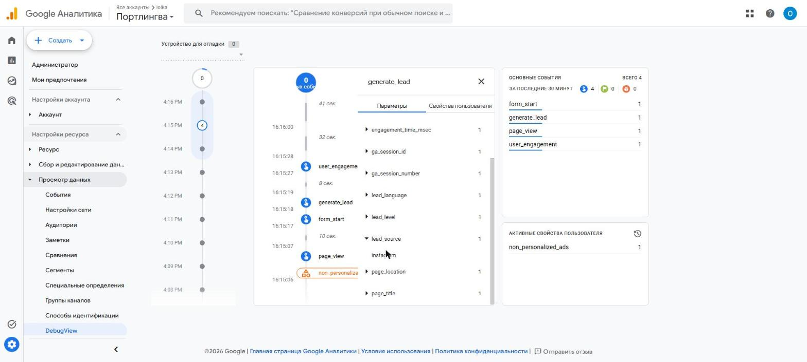
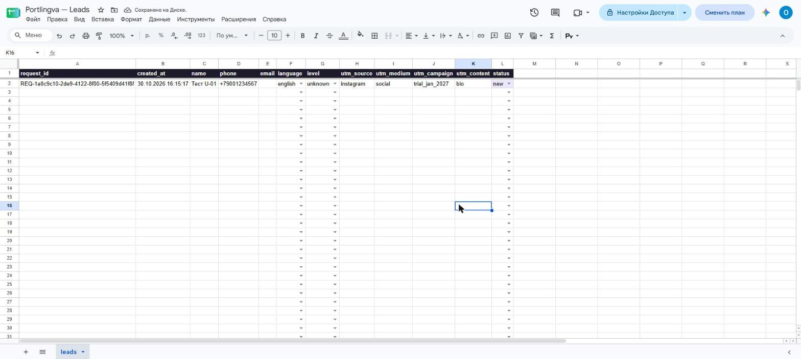
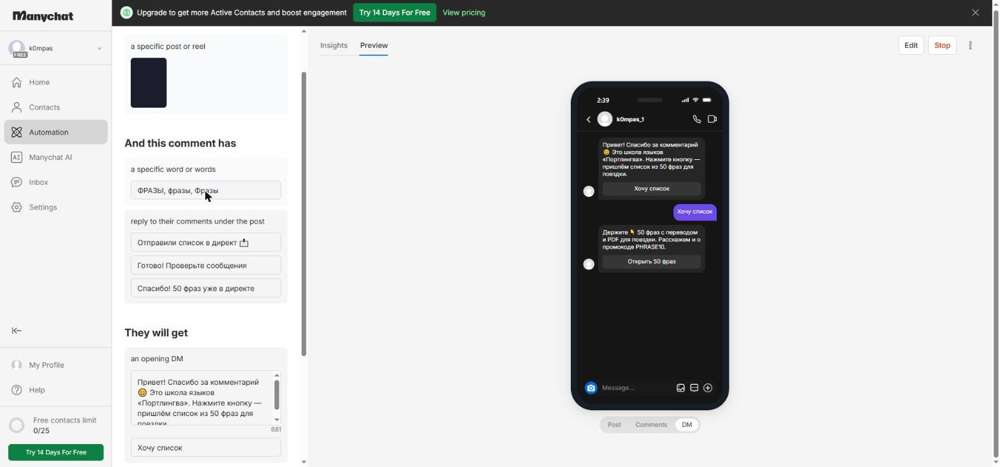
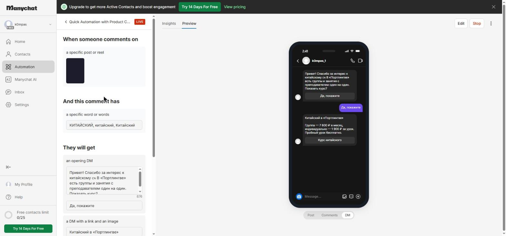
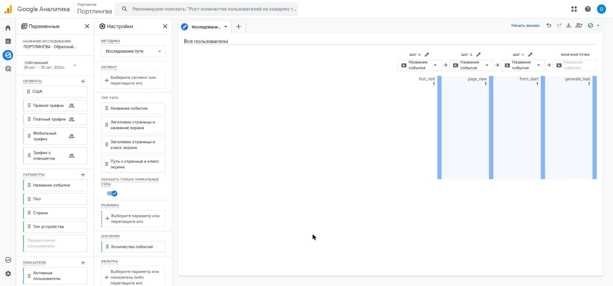
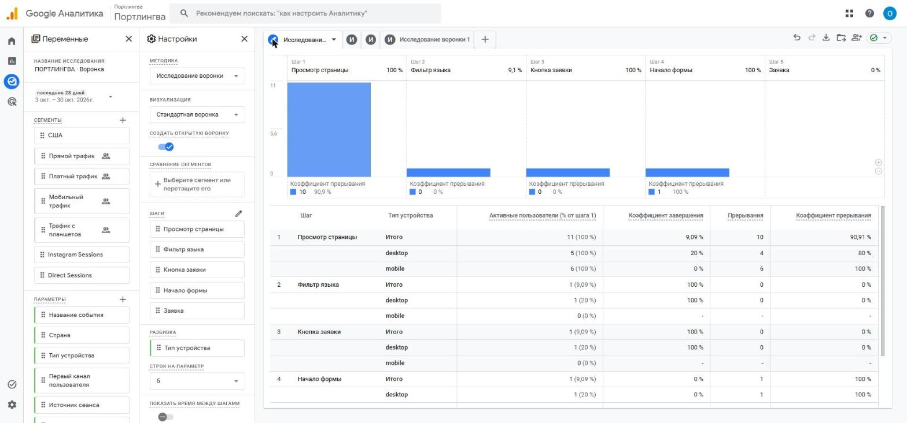

# Описание работы · ТЗ № ТЗ-05/2026 · «Портлингва»

**Исполнитель:** Михеев Николай Сергеевич, группа РПО-26/1/11
**Сайт:** https://portlingva.vercel.app
**Период проверок:** 29.10.2026 — 31.10.2026

## 1. Задача заказчика

В школе «Портлингва» 640 учеников и 22 преподавателя. В сентябре 2026 года на пробный урок записались 190 человек, пришли 132, купили курс 61. Школа не знала, какой канал (Instagram, ВКонтакте, Telegram, YouTube, блогеры, QR-код) приводит покупателей, а менеджеры до двух часов в день отвечали на вопрос «Какой у меня уровень?».

Задача — к 1 декабря сделать сайт с курсами, онлайн-тестом уровня, ценами и записью на пробный урок. Каждая заявка должна попадать в одну таблицу с языком, уровнем и источником.

## 2. Схема работы

Посетитель приходит по ссылке с UTM-метками. Метки сохраняются в `sessionStorage` и не теряются при переходах по сайту. Сайт отправляет события в GA4, а заявку — в Apps Script, который проверяет её и дописывает строку в лист `leads`. Событие `generate_lead` уходит только после ответа приёмника `{"ok": true}`.

## 3. Сайт

10 страниц на HTML, CSS и JavaScript без сборки, в фирменных цветах (#5B3FC4, #3CCFAE) и шрифтах Nunito и Inter. Есть тест уровня, форма с проверкой полей, видео с урока, PDF-файлы и OG-картинка 1200×630.

| Главная, 1280 px | Телефон, 375 px |
|---|---|
|  |  |

Lighthouse (мобильный режим): производительность **99**, доступность **94**, рекомендации **100**, SEO **100**.

## 4. Аналитика GA4

Ресурс с Measurement ID `G-2CZ494QV10`. Тег стоит в `<head>` каждой страницы. 20 событий (6 автоматических и 14 своих) отправляются из одного файла `js/analytics.js` ([events.md](events.md)). Кнопки размечены атрибутами `data-event`, общий обработчик отправляет события с параметрами. Имя, телефон и e-mail в GA4 не передаются.

Зарегистрированы 7 пользовательских параметров. При проверке выяснилось, что `gtag` воспринимает `language` как служебное поле (язык браузера), поэтому сайт отправляет `lang`, а правило «Изменение события» в GA4 переименовывает его в `language`.

## 5. UTM-ссылки и соцсети

Реестр из 12 ссылок кампании `trial_jan_2027` по правилам ТЗ ([utm.md](utm.md)): Instagram (шапка, автоответ, ветка «КИТАЙСКИЙ», Stories), ВКонтакте, Telegram, YouTube, два блогера и QR-код на визитках. Для U-12 сделан QR-код и афиша A4.

## 6. Заявки

Форма на странице «Запись» проверяет поля, показывает ошибку под полем и отправляет заявку `fetch`-запросом без перезагрузки. Apps Script ещё раз проверяет данные, берёт блокировку, отклоняет повторный `request_id`, сам ставит `created_at` и `status = new`. В таблице — выпадающие списки и подсветка пустых ячеек и дублей.

## 7. Instagram и автоответы

Аккаунт k0mpas_1 переведён в бизнес-аккаунт, опубликован Reel «5 фраз, по которым в Лондоне узнают русского». В ManyChat (тариф Free) работают две автоматизации на этот Reel:

- **ФРАЗЫ** — ответ в комментариях и сообщение в Direct с кнопкой на `phrases.html` (ссылка U-02);
- **КИТАЙСКИЙ** — ответ в комментариях и карточка курса с кнопкой на `courses.html#chinese` (U-03).

| ФРАЗЫ | КИТАЙСКИЙ |
|---|---|
|  |  |

Живой тест комментарием со второго аккаунта не проводился: второго аккаунта нет. Сценарии проверены в предпросмотре ManyChat.

## 8. Отчёты

В GA4 созданы исследования: свободная форма по кампании `trial_jan_2027`; воронка из 5 шагов (`page_view` → `language_filter` → `cta_click` → `form_start` → `generate_lead`) — открытая, закрытая, по устройствам и с ограничением 10 минут; путь от `/phrases.html` и обратный путь к `generate_lead`. Атрибуция — «На основе данных», окна 30 и 90 дней. Оповещение приходит на почту, если трафик из Instagram падает больше чем на 50 %.

За 29–31.10.2026: 17 сеансов, из них 3 из Instagram по кампании `trial_jan_2027` (вовлечённость 100 % против 36 % у прямых заходов). Наибольшая потеря в воронке — на первом шаге: до выбора языка доходит 1 из 11 посетителей. Гипотеза — показать карточки языков на первом экране главной. Полная записка — [report.md](report.md).

 **Дашборд DataLens не выполнен: сервис не работал.** Публикации во ВКонтакте, Telegram и YouTube не делались, ссылки для них готовы в реестре.

## 9. Что получил бизнес

| Было | Стало |
|---|---|
| Заявки из разных каналов без общего учёта | Все заявки в одной таблице со статусом до оплаты |
| Источник клиента неизвестен | У каждой заявки есть source, medium, campaign и content |
| Менеджеры вручную определяют уровень | Онлайн-тест сам определяет уровень и подставляет его в заявку |
| Ответы на комментарии в Instagram — вручную | ManyChat отвечает сразу и ведёт на сайт с метками |

## 10. Итог

Сайт, аналитика, учёт заявок и автоответы работают. Нейросеть (Claude) использовалась для подсказок по коду, текстам и документации, запросы — в [prompts.md](prompts.md).
